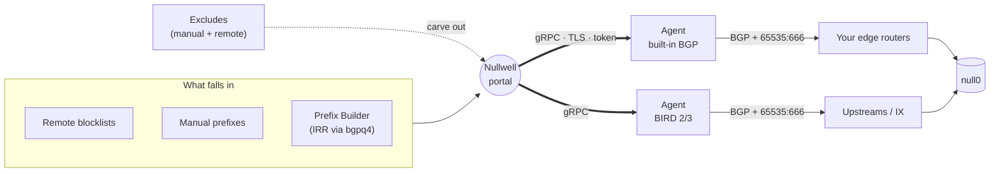

<div align="center">

<picture>
  <source media="(prefers-color-scheme: dark)" srcset="brand/nullwell-horizontal-dark.svg">
  
</picture>

### Send it to nothing.

**Nullwell** is a self-hosted RTBH controller for networks that would rather stay up.<br>
It gathers blocklists, decides what should vanish, and announces it to your routers over BGP.<br>
Attack traffic falls in. Nothing comes out.


[Launch sequence](#-launch-sequence) ·
[How the well works](#-how-the-well-works) ·
[Enrolling agents](#-enrolling-agents) ·
[Configuration](#-configuration) ·
[API](#-api) ·
[Field notes](#-field-notes)

</div>

---

```
   ════════════════╗                         ╔════════════════
    198.51.100.7   ╚══╗                   ╔══╝   your network
    203.0.113.0/24    ╚══╗             ╔══╝      stays up
    2001:db8:bad::/48    ╚══╗       ╔══╝
                            ╚══╗ ╔══╝
                               ╚●╝  ← null0
```

A DDoS doesn't have to reach the servers to win. It only has to fill the pipe in front of
them. **Remotely Triggered Black Hole** routing (RTBH) fixes that at the edge: you tag the
target prefix with a BLACKHOLE community, your routers and upstreams drop it at the door,
and the rest of the network keeps breathing.

Nullwell makes that boring, in the best way. It's the control room: one place to decide
*what* goes into the well, and a fleet of small agents that make sure every router hears it.

> [!NOTE]
> Nullwell is the new name for **RTBHID**. Binaries (`rtbh-portal`, `rtbhd`), environment
> variables (`RTBH_*`) and service names keep their old names, so existing installs upgrade
> in place.

## ✦ What's inside

<table>
<tr>
<td width="50%" valign="top">

**🕳️ The feed**
- Manual prefixes, single or bulk, with notes
- Remote blocklists fetched on a schedule; failing sources back off (1m, 2m, 4m… up to the source interval)
- **Prefix Builder**: expand an ASN into its IRR route objects (`bgpq4`), review, blackhole or exclude
- IPv4 and IPv6 throughout

</td>
<td width="50%" valign="top">

**🛟 The exceptions**
- Manual excludes and remote exclude lists (e.g. a CDN's published ranges)
- CIDR-aware: excluding `192.0.2.0/24` protects everything inside it from every source
- **IP Lookup**: "is this address blackholed right now, and why?", with the evidence

</td>
</tr>
<tr>
<td valign="top">

**📡 The fleet**
- Agents run a **built-in, announce-only BGP-4 speaker**, or drive **BIRD 2/3** via generated config
- TCP MD5 (RFC 2385, Linux), 4-byte ASNs, AS4_PATH
- Peers from the portal, plus auto-accept from an ASN whitelist (Indonesian ASNs importable from all five RIRs)
- **One-line agent install** with per-node enrollment tokens

</td>
<td valign="top">

**🔭 The instruments**
- Dashboard that answers one question first: *is the feed live, and are routers receiving it?*
- BGP Monitor per session: state, uptime, prefixes announced, last error
- Prometheus `/metrics`, optional bearer token
- Calm NOC UI: light and dark, large-text mode, works on a phone at 3 a.m.

</td>
</tr>
</table>

## ✦ How the well works



The portal computes one **effective feed** and streams it to every agent:

```
feed  =  manual  ∪  ( sources  −  excludes )
```

- **Manual always wins.** If you blackholed it by hand, an exclude won't silently undo it.
- **Excludes cover their whole range.** A `/16` exclude removes every `/24` and `/32` inside it from every source.
- **Nothing too wide.** Prefixes shorter than IPv4 `/8` or IPv6 `/16` never leave the portal, whatever a list says. A broken or hostile blocklist can't announce `0.0.0.0/0`.
- **Agents hold no state.** They receive the full feed on connect, then deltas as sources sync. Restart one and it's whole again in a second.

### Gravity, measured

The built-in speaker is benchmarked against real-world feed sizes
(`go test ./internal/bgpserver -bench .`, Apple M2 Pro, loopback):

| Scenario | 160k prefixes | 250k prefixes |
|---|---|---|
| Router connects, receives the full feed | **7.9 ms** · 819 UPDATEs · 0.86 MB on the wire | 12.3 ms · 1,279 UPDATEs · 1.34 MB |
| Reconcile with nothing changed (no UPDATEs sent) | 27 ms | 43 ms |
| Build the announcement snapshot | 32 ms · 42 allocations | 43 ms · 45 allocations |

Your mileage depends on the link and the router, but the controller won't be the slow part.

## ✦ Launch sequence

### 1 · Build

You need **Go 1.25+** and **Node 20+**. `bgpq4` on the portal host enables the Prefix Builder.

```bash
git clone https://github.com/jalabyte/rtbhid.git && cd rtbhid
(cd web && npm install)

make portal          # bin/rtbh-portal (React UI embedded)
make agent           # bin/rtbhd
make all-linux       # bin/*-linux-amd64 for your servers
```

### 2 · Ignite the portal

```bash
sudo install -m 0755 bin/rtbh-portal-linux-amd64 /usr/local/bin/rtbh-portal
sudo install -m 0644 deploy/systemd/rtbh-portal.service /etc/systemd/system/
sudo install -m 0600 deploy/systemd/rtbh-portal.env.example /etc/default/rtbh-portal
sudo $EDITOR /etc/default/rtbh-portal      # set RTBH_AUTH_USER / RTBH_AUTH_PASS at least
sudo systemctl enable --now rtbh-portal
```

Open `http://your-portal:8088`, add a blocklist under **Sources**, and watch the feed fill.
Put it behind a TLS reverse proxy before it faces the internet (example below).

### 3 · Add an agent, in one line

In the portal: **Agents → Add agent**, name it, copy the command, run it on the new node:

```bash
curl -fsSL https://portal.example.net/install-agent.sh | sudo bash -s -- --token rtbh_… --name edge-1
```

That's the whole ritual. The script downloads `rtbhd` for the node's CPU (amd64 or arm64),
installs it as a systemd service with the built-in BGP speaker on TCP/179, enrolls it with
the portal, and waits until it has registered. Optional: `--asn`, `--router-id`,
`--nexthop-v4`, `--nexthop-v6`. Re-running it upgrades the binary and keeps a `.bak` of the
old config.

### 4 · Point routers at it

Peer your routers with the agent and honour the BLACKHOLE community (RFC 7999,
`65535:666`) by routing those prefixes to discard. The portal's public **`/docs`** page has
copy-paste examples for **BIRD, Junos, IOS/IOS-XE, Arista EOS, Huawei VRP and RouterOS**.

## ✦ Enrolling agents

Agents talk to the portal over gRPC. For agents on other hosts, publish the gRPC port
through TLS and let each node prove itself with its own token.

```caddy
agent.example.net {
    reverse_proxy h2c://127.0.0.1:50051 {
        flush_interval -1        # stream config updates immediately
    }
}
```

```bash
# /etc/default/rtbh-portal
RTBH_AGENT_PORTAL_URL=agent.example.net:443        # what agents dial; empty disables enrollment
RTBH_AGENT_BINARY_DIR=/usr/local/lib/rtbh-portal/agent   # holds rtbhd-linux-amd64 / -arm64
```

**The trust model, in four rules:**

1. **One token, one node.** A token binds to the first agent ID that registers with it; any other node presenting it is refused.
2. **Tokens are stored hashed** (SHA-256) and shown once, in the install command.
3. **Revoking cuts the cord now.** The node's config stream is closed immediately and its reconnects are rejected.
4. **The portal's own host is trusted.** An agent connecting over loopback, not via a proxy, needs no token. That keeps single-box installs working; Caddy always adds `X-Forwarded-For`, so proxied agents can't pose as local ones.

The binary download also requires a valid token, so the endpoint isn't a public mirror.

> [!TIP]
> Running Cloudflare's proxy in front of the agent hostname works (gRPC must be enabled in
> the zone's Network settings). If a stream is ever idled out, the agent reconnects within
> five seconds and receives the full feed again; watch `journalctl -u rtbhd` for repeated
> `applying config` lines if you suspect it.

## ✦ Configuration

Everything is environment variables; there are no config files.

<details>
<summary><b>Portal</b> (<code>rtbh-portal</code>)</summary>

| Variable | Default | What it does |
|---|---|---|
| `RTBH_LISTEN_ADDR` | `:8088` | HTTP (UI + API) |
| `RTBH_GRPC_ADDR` | `:50051` | gRPC for agents; bind to `127.0.0.1` behind a proxy |
| `RTBH_GRPC_MAX_MSG_SIZE` | `0` (4 MB) | Max gRPC message; raise for very large feeds |
| `RTBH_DB_PATH` | `./data/portal.db` | SQLite database |
| `RTBH_LOCAL_ASN` | `65500` | ASN agents use by default |
| `RTBH_SCHEDULER_TICK_SECONDS` | `15` | How often source intervals are checked |
| `RTBH_AGENT_PORTAL_URL` | *(off)* | Address remote agents dial, e.g. `agent.example.net:443` |
| `RTBH_AGENT_PORTAL_TLS` | `true` | Whether installed agents use TLS to reach it |
| `RTBH_AGENT_BINARY_DIR` | *(off)* | Directory with `rtbhd-linux-amd64` / `rtbhd-linux-arm64` for the installer |
| `RTBH_BGP_AUTO_ACCEPT` | `true` | Agents accept inbound sessions from whitelisted ASNs |
| `RTBH_WHITELIST_STRICT_ID` | `true` | Manual whitelist adds must be Indonesian ASNs (per RIR data) unless overridden |
| `RTBH_ID_ASN_SOURCE_URL(S)` | all five RIRs | Override the Indonesian ASN sources |
| `RTBH_ASN_NAME_SOURCE_URL` | bgp.tools CSV | ASN holder names (falls back to iptoasn, RIPE) |
| `RTBH_IPINFO_TOKEN` | *(off)* | ipinfo.io token for ASN lookups |
| `RTBH_METRICS_TOKEN` | *(public)* | Require a bearer token (or `?token=`) on `/metrics` |
| `RTBH_AUTH_USER` / `RTBH_AUTH_PASS` | *(off)* | Enable login |
| `RTBH_AUTH_SESSION_SECRET` | *(random)* | Session signing key; set it so sessions survive restarts |
| `RTBH_AUTH_SESSION_TTL_HOURS` | `24` | Session lifetime |
| `RTBH_AUTH_COOKIE_SECURE` | `false` | Set `true` behind HTTPS |

</details>

<details>
<summary><b>Agent</b> (<code>rtbhd</code>, <code>RTBH_MODE=agent</code>)</summary>

| Variable | Default | What it does |
|---|---|---|
| `RTBH_MODE` | `standalone` | `agent` to connect to a portal |
| `RTBH_PORTAL_URL` | `localhost:50051` | Portal gRPC address |
| `RTBH_PORTAL_TLS` | `false` | Dial the portal over TLS (system CA roots) |
| `RTBH_AGENT_TOKEN` | *(none)* | Enrollment token; sent only over TLS |
| `RTBH_AGENT_NAME` | hostname | Name shown in the portal |
| `RTBH_BGP_ENGINE` | `bird` | `custom` for the built-in speaker, `bird` for BIRD config |
| `RTBH_BGP_LISTEN_ADDR` | `:179` | Built-in speaker listen address |
| `RTBH_BGP_ROUTER_ID` | derived | BGP identifier (IPv4) |
| `RTBH_BGP_NEXTHOP_V4` / `_V6` | session address | Next hop on announcements |
| `RTBH_BGP_HOLD_TIME_SEC` | `90` | Hold time |
| `RTBH_BGP_ENABLE_IPV6` | `true` | Advertise IPv6 unicast |
| `RTBH_LOCAL_ASN` | `65500` | Local ASN |
| `RTBH_EXPORT_STD_COMMUNITIES` | *(none)* | Standard communities on every route, e.g. `65535:666` |
| `RTBH_EXPORT_LARGE_COMMUNITIES` | *(none)* | Large communities |
| `RTBH_GRPC_MAX_MSG_SIZE` | `0` (4 MB) | Max config message the agent accepts |
| `RTBH_BIRD_OUTPUT` | `./data/rtbh_auto.conf` | BIRD engine: routes file |
| `RTBH_BIRD_PEERS_OUTPUT` | `./data/rtbh_peers_auto.conf` | BIRD engine: peers file |
| `RTBH_BIRD_RELOAD` / `RTBH_BIRD_COMMAND` | `false` / `birdc configure` | Reload BIRD after writing |
| `RTBH_BIRD_VERSION` | auto-detected | Override BIRD version detection |

With the BIRD engine, include the generated files in `bird.conf`:

```bird
include "/etc/bird/rtbh_auto.conf";
include "/etc/bird/rtbh_peers_auto.conf";
```

</details>

<details>
<summary><b>Standalone</b> (legacy single-router mode)</summary>

`rtbhd` without `RTBH_MODE=agent` runs the original all-in-one controller with a JSON state
file and its own small dashboard, writing BIRD config directly. New installs should use
portal + agents.

```bash
RTBH_STATE_PATH=/var/lib/rtbhd/state.json \
RTBH_BIRD_OUTPUT=/etc/bird/rtbh_auto.conf \
RTBH_BIRD_RELOAD=true \
./bin/rtbhd
```

</details>

## ✦ Observability

`GET /metrics` speaks Prometheus:

| Metric | Labels |
|---|---|
| `rtbhid_bgp_agents`, `rtbhid_bgp_sessions_total`, `rtbhid_bgp_sessions_established`, `rtbhid_bgp_sessions_stale` | |
| `rtbhid_bgp_prefixes_announced`, `rtbhid_bgp_prefixes_received` | |
| `rtbhid_agent_bgp_sessions`, `rtbhid_agent_bgp_sessions_established` | `agent`, `engine` |
| `rtbhid_agent_bgp_prefixes_announced`, `rtbhid_agent_bgp_prefixes_received` | `agent`, `engine` |
| `rtbhid_bgp_session_up` | `agent`, `peer`, `remote_as`, `passive` |
| `rtbhid_bgp_session_stale` | `agent`, `peer` |

A good first alert: `rtbhid_bgp_sessions_established == 0` for five minutes. The feed is
being built, but no router is listening.

## ✦ API

JSON over HTTP under `/api/v1/`, authenticated with the session cookie from
`POST /api/v1/auth/login` when auth is enabled.

<details>
<summary>Endpoints</summary>

```http
GET    /api/v1/status                          counts, local ASN, effective feed size
GET    /api/v1/health

GET    /api/v1/prefixes                        POST, POST /bulk, PUT /:id/toggle, DELETE /:id
GET    /api/v1/sources                         POST, PUT /:id/toggle, POST /:id/sync, DELETE /:id
GET    /api/v1/excludes                        POST, POST /bulk, DELETE /:id
GET    /api/v1/exclude-sources                 POST, PUT /:id/toggle, POST /:id/sync, DELETE /:id
GET    /api/v1/exclude-sources/prefixes        everything remote excludes currently cover

POST   /api/v1/lookup                          {"queries": ["192.0.2.10", "2001:db8::/48"]}
POST   /api/v1/prefix-builder                  {"asn": "AS64500", "ipv4": true, "ipv6": true, "sources": ["RADB"]}

GET    /api/v1/peers                           POST, POST /bulk, PUT /:id/toggle, DELETE /:id
GET    /api/v1/whitelist                       POST, PUT /:id/toggle, PUT /auto-accept, POST /import, DELETE /:id
GET    /api/v1/bgp                             sessions across all agents

GET    /api/v1/agents                          DELETE /:id
GET    /api/v1/agent-tokens                    POST {"name": "edge-1"} → token (once), DELETE /:id revokes
GET    /api/v1/events?limit=100

GET    /install-agent.sh                       public; holds no secrets
GET    /download/rtbhd-linux-{amd64,arm64}     requires "Authorization: Bearer <agent token>"
GET    /metrics                                public unless RTBH_METRICS_TOKEN is set
```

</details>

## ✦ Field notes

**Security posture of the built-in speaker**

- It is **announce-only**: it never installs or accepts routes from peers.
- Auto-accept trusts the ASN a peer *claims* in its OPEN message. Restrict TCP/179 to your
  peering networks, and use TCP MD5 (`password` on the peer) where peers support it.
- GTSM (TTL security) isn't implemented; use the BIRD engine where a peer requires it.
- Stop `bird.service` before switching an agent to `custom`; both want TCP/179. The systemd
  unit grants `CAP_NET_BIND_SERVICE` so `rtbhd` doesn't need root.

**Portal hygiene**

- Enable auth, set a long random `RTBH_AUTH_SESSION_SECRET`, serve over HTTPS with
  `RTBH_AUTH_COOKIE_SECURE=true`.
- Keep gRPC on `127.0.0.1` and expose it only through the TLS proxy.

<details>
<summary><b>Troubleshooting</b></summary>

| Symptom | Look at |
|---|---|
| Agent: `Unauthenticated … token missing, revoked, or issued to another agent` | The token was revoked, or it belongs to another node. Create a new one under **Agents → Add agent** |
| Installer: `download failed` | Token typo, or `RTBH_AGENT_BINARY_DIR` has no binary for this CPU |
| Installer: `another process listens on TCP 179` | BIRD is still running on the node: `systemctl disable --now bird` |
| Prefix Builder: `IRR query timed out` | Public IRR servers are slow at times; retry, or select fewer sources |
| Dashboard: *Not reaching any router* | Agents are connected but no BGP session is established; check **BGP Monitor** for the last error |
| A source shows *Sync failing* | Hover for the error; it retries with backoff, and **Sync** forces an immediate retry |
| BIRD engine: `permission denied` on `birdc` | Add `rtbhd` to the `bird` group, then restart the agent |

</details>

## ✦ Building from source

```bash
make test            # Go tests
(cd web && npm test) # UI tests (vitest)
make proto           # regenerate gRPC code (needs buf)
(cd web && npm run dev)   # UI with hot reload on :5173, proxied to the portal on :8088
```

```
cmd/portal        portal entrypoint (embeds web/dist)
cmd/agent         rtbhd: agent and legacy standalone mode
internal/portal   feed computation, scheduler, SQLite store, HTTP + gRPC APIs
internal/bgpserver  the announce-only BGP-4 speaker
internal/agent    engines (built-in BGP, BIRD) and the portal client
web/              React + Tailwind UI
brand/            logo, icons and usage guidelines
```

---

<div align="center">


**Nullwell** · built by [PT Jala Informatika Nusantara](https://jalabyte.com) · idea from Rifqi Arief Pamungkas (Rapdodge)<br>
Support: support@jalabyte.com · Copyright © 2026 PT Jala Informatika Nusantara

<sub>Everything that falls in stays in. That's the point.</sub>

</div>
